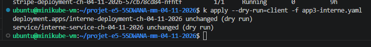
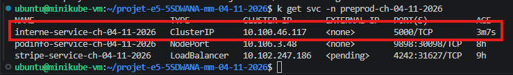
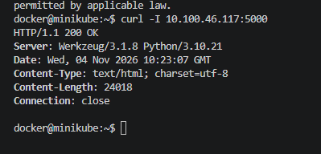
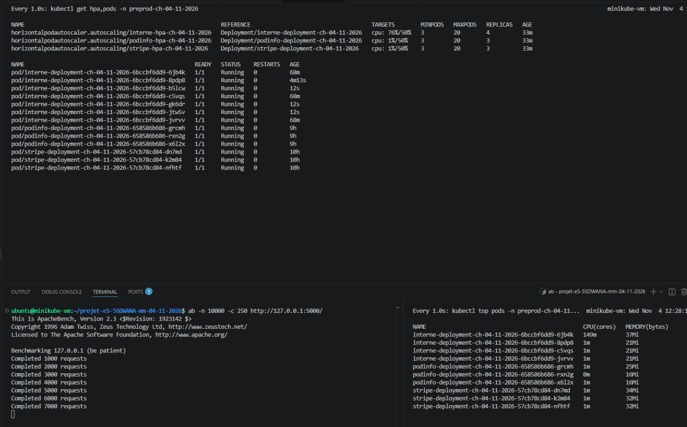
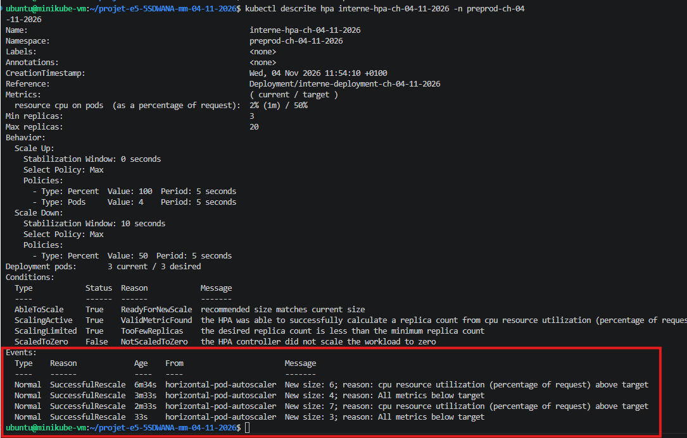
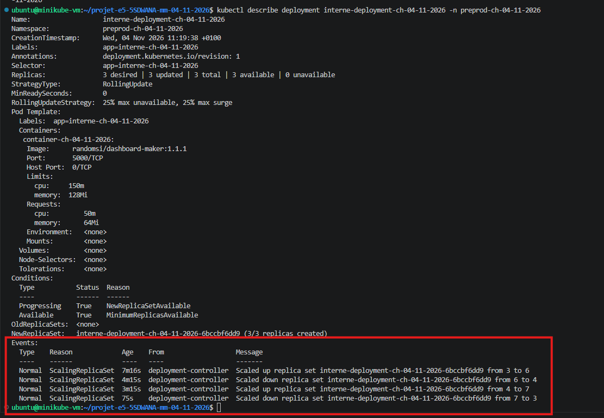

# Application 3 : Dashboard Maker (interne)

**Projet :** TP E5 5SDWANA Metz  
**Groupe :** Mohamed CHAOUAY TISSIR et Mattéo HEIB  
**Statut :** accès interne, réponse HTTP 200 et test HPA validés dans Preprod.

## Objectif

Déployer la troisième application du TP dans Kubernetes avec un accès **interne uniquement**, via un Service de type `ClusterIP`, puis vérifier l'autoscaling horizontal.

## Configuration relevée

| Élément | Valeur |
|---|---|
| Application | Dashboard Maker (Flask) |
| Image Docker | `randomsi/dashboard-maker:1.1.1` |
| Namespace | `preprod-ch-04-11-2026` |
| Deployment | `interne-deployment-ch-04-11-2026` |
| Service | `interne-service-ch-04-11-2026` |
| Type de Service | `ClusterIP` |
| Port | `5000` |
| Adresse IP observée | `10.100.46.117` (IP interne susceptible de changer) |
| Replicas au repos | 3 |

## Vérifications réalisées

1. **Manifeste :** `kubectl apply --dry-run=client -f app3-interne.yaml` vérifie la configuration sans effectuer de nouveau déploiement.
2. **Service :** `kubectl get svc -n preprod-ch-04-11-2026` confirme le type `ClusterIP` et le port `5000`.
3. **Accès HTTP interne :** une requête `curl -I 10.100.46.117:5000` depuis Minikube a renvoyé `HTTP/1.1 200 OK`.
4. **Replicas :** les trois pods de Dashboard Maker étaient disponibles avant le test HPA.

### Captures des vérifications

**Vérification du manifeste (dry-run)**



**Service interne ClusterIP**



**Réponse HTTP 200 depuis Minikube**



## Test de charge et autoscaling HPA

Nous avons généré du trafic sur Dashboard Maker avec **ApacheBench** afin de vérifier la réaction de l'Horizontal Pod Autoscaler (HPA).

```bash
ab -n 10000 -c 250 http://127.0.0.1:5000/
```

| Indicateur | Résultat |
|---|---|
| Outil de charge | ApacheBench (`ab`) |
| Requêtes prévues | 10 000 |
| Connexions simultanées | 250 |
| Replicas minimum | 3 |
| Replicas maximum configurés | 20 |
| Cible d'utilisation CPU | 50 % |
| Maximum demandé observé | 7 replicas |
| Retour au repos | 3 replicas |

Les événements `SuccessfulRescale` du HPA et `ScalingReplicaSet` du Deployment montrent les changements successifs **3 → 6 → 4 → 7 → 3**. Le nombre de pods s'adapte donc automatiquement à la consommation CPU, puis revient au minimum après la charge.

Ces captures démontrent les décisions de mise à l'échelle de Kubernetes. Elles ne constituent pas, à elles seules, une mesure détaillée des temps de réponse ou du taux d'erreurs du test ApacheBench.

### Captures du test HPA

**Test de charge et surveillance des pods**



**Événements du HPA**



**Évolution des replicas dans le Deployment**



## Bilan et suite

L'application interne répond en HTTP 200, dispose de trois replicas au repos et son **HPA a réussi un cycle de montée et de descente de charge** dans `preprod-ch-04-11-2026`.

