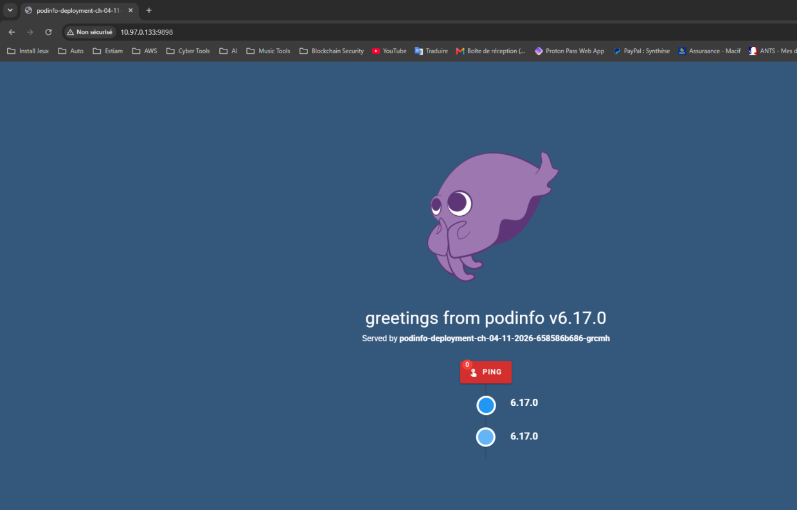
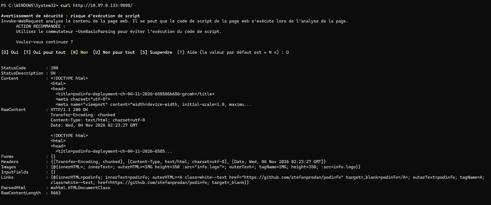
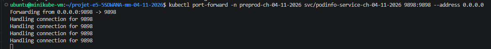
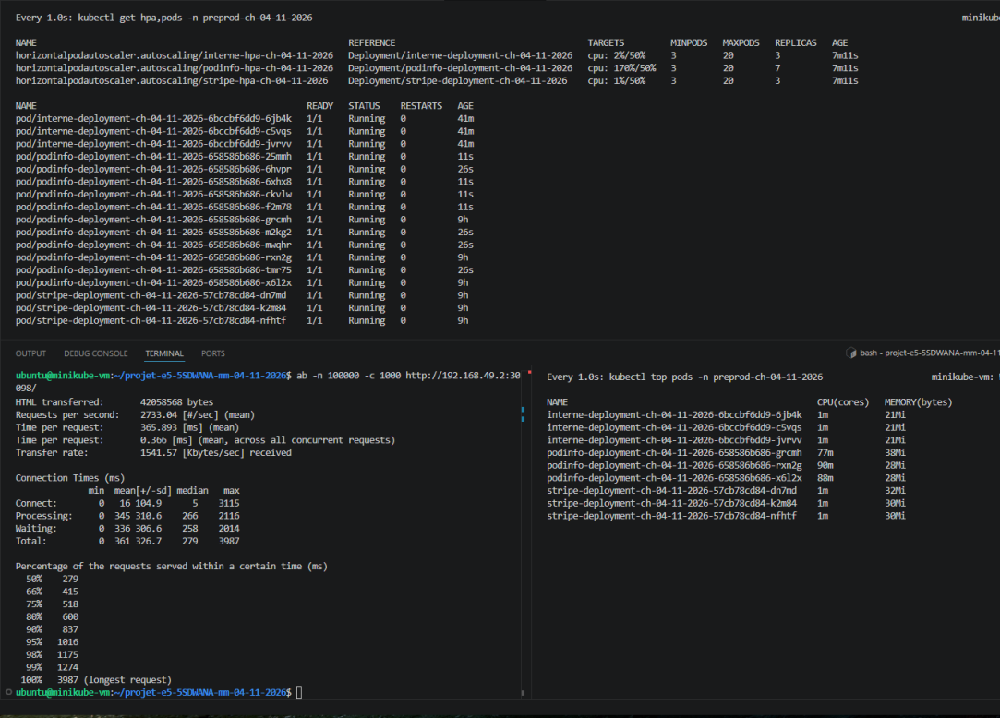
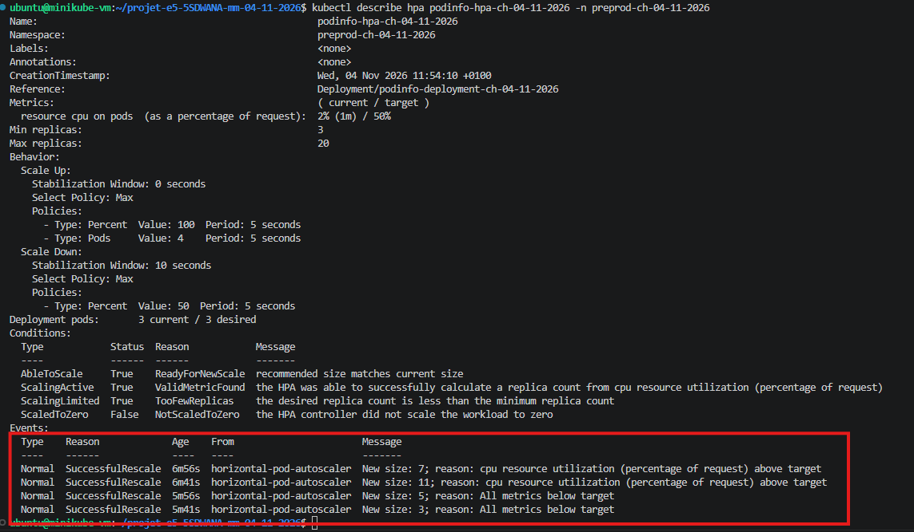
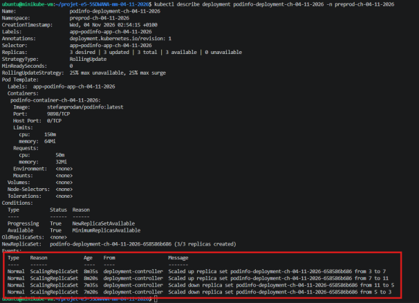

# Application 2 : Podinfo (Go)

**Projet E5 5SDWANA Metz — Groupe Mohamed CHAOUAY TISSIR et Mattéo HEIB**  
**État : application accessible, premier test HTTP validé — 04/11/2026**

## Présentation

Podinfo est une petite application web développée en **Go**, utilisée pour tester les déploiements Kubernetes et, plus tard, l'autoscaling avec le HPA.

Nous avons choisi l'image Docker Hub [`stefanprodan/podinfo:6.17.0`](https://hub.docker.com/r/stefanprodan/podinfo), légère et facile à démarrer.

## Configuration observée

| Élément | Valeur |
|---|---|
| Application | Podinfo v6.17.0 |
| Namespace | `preprod-ch-04-11-2026` |
| Deployment | `podinfo-deployment-ch-04-11-2026` |
| Service | `podinfo-service-ch-04-11-2026` |
| Port applicatif | `9898` |
| Accès testé | Transfert de port Kubernetes |

## Tests réalisés

- Ouverture de l'interface Podinfo depuis un poste Windows : **page affichée correctement**.
- Vérification de la réponse HTTP depuis PowerShell : **`200 OK`**.
- Vérification du transfert de port vers le Service Kubernetes.

Commande utilisée pour le test d'accès :

```bash
kubectl port-forward -n preprod-ch-04-11-2026 \
  svc/podinfo-service-ch-04-11-2026 9898:9898 --address 0.0.0.0
```

Le paramètre `--address 0.0.0.0` a servi au test depuis un autre poste. Il expose le port sur toutes les interfaces de la VM : à limiter au réseau de test et à arrêter après utilisation. Ce transfert temporaire ne prouve pas encore l'accès externe définitif par le Service.

## Captures de vérification

**1. Interface Podinfo**



**2. Test HTTP 200 depuis Windows**



**3. Transfert de port Kubernetes**



### Test de charge et autoscaling HPA

Nous avons réalisé un test de charge sur Podinfo à l'aide d'**ApacheBench**, avec 100 000 requêtes et 1 000 connexions simultanées.

Le HPA a été configuré avec un minimum de **3 pods**, un maximum de **20 pods** et une cible CPU de **50 %**.

**Résultats :**

| Indicateur | Résultat |
|---|---|
| Débit moyen | 2 733 requêtes/seconde |
| Temps de réponse moyen | 365,89 ms |
| Temps de réponse p95 | 1 016 ms |
| Replicas au départ | 3 |
| Maximum demandé par le HPA | 11 |
| Replicas après le test | 3 |

Lors du test, Kubernetes a automatiquement augmenté le nombre de replicas de **3 à 7, puis à 11**. Après la diminution de la charge, le nombre de replicas est redescendu à **5 puis à 3**.

Les événements Kubernetes `SuccessfulRescale` confirment le fonctionnement de l'autoscaling horizontal.

**Captures des résultats :**






