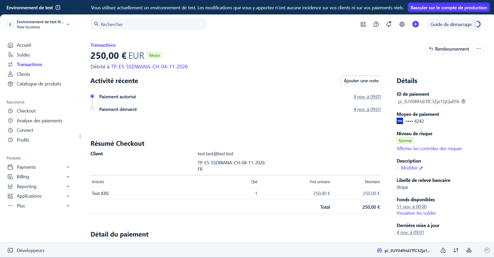
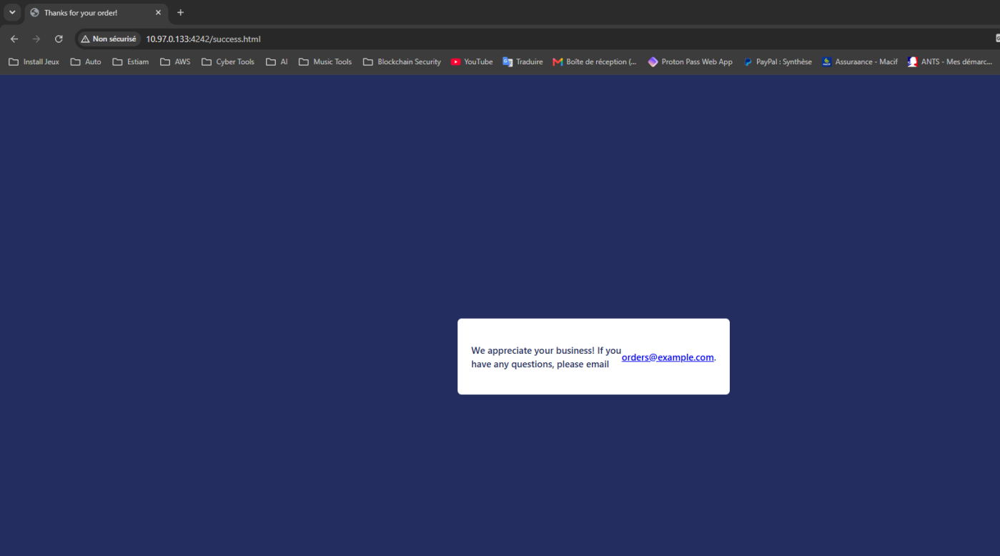
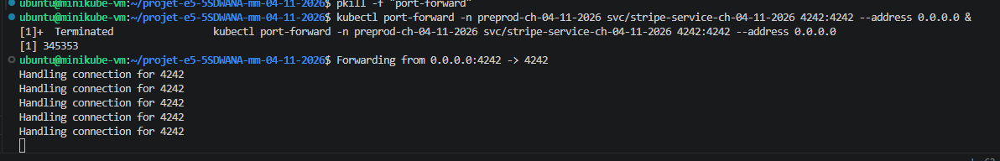
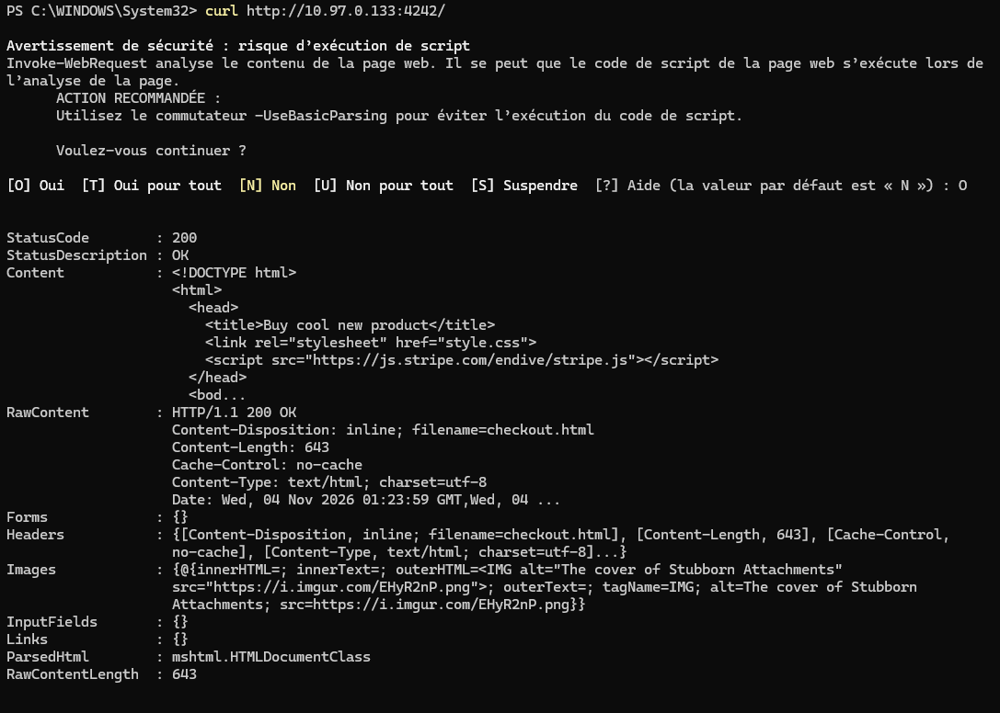
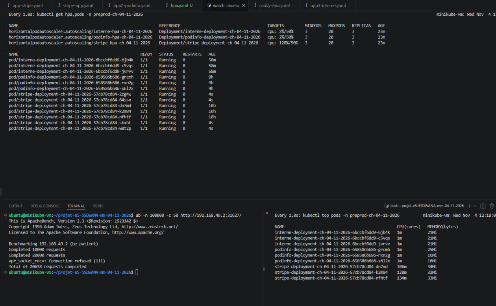
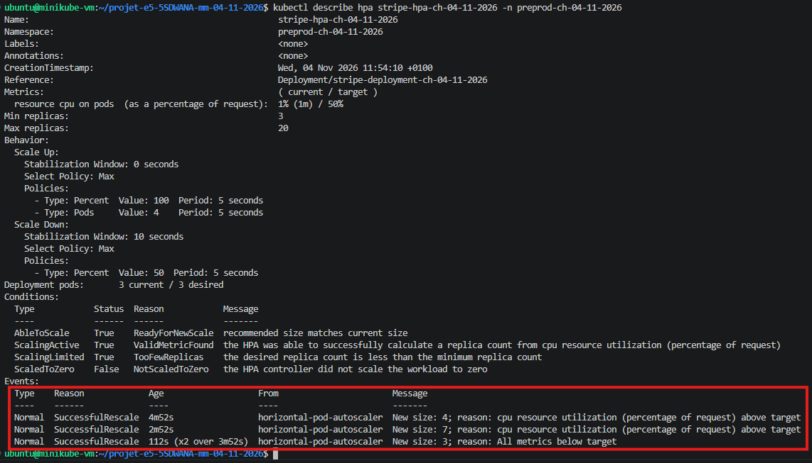
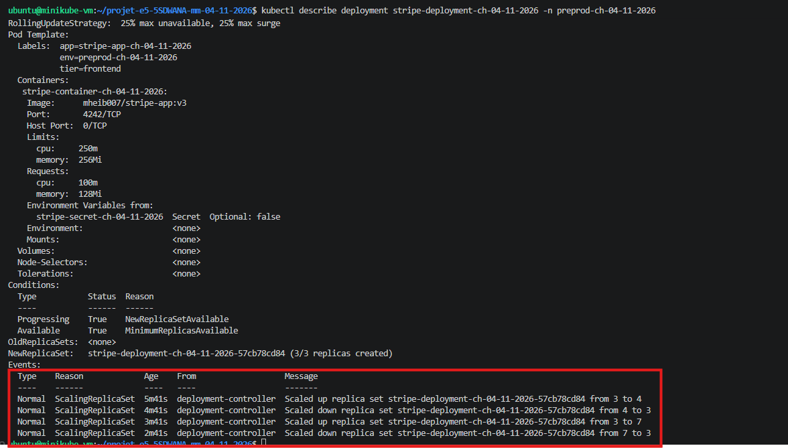

# Application 1 : Stripe Checkout

**Projet E5 5SDWANA Metz**  
**Test effectué le 4 novembre 2026**  
**Statut : paiement de test validé**

## Présentation

Cette application permet de simuler un achat en ligne à l'aide de **Stripe Checkout**, dans un environnement de test. Elle est déployée sur **Minikube / Kubernetes** et communique avec Stripe pour traiter le paiement.

## Vérifications réalisées

- L'application est accessible depuis un poste Windows grâce à un transfert de port Kubernetes vers le service `stripe-service-ch-04-11-2026` dans le namespace `preprod-ch-04-11-2026`.
- Une requête HTTP vers l'application a retourné le code **200 OK**.
- Un achat fictif de **250,00 €** a été effectué avec une carte de test Stripe.
- Le paiement apparaît avec le statut **« Réussi »** dans le Dashboard Stripe en mode test.
- Le navigateur a été redirigé vers la page de confirmation après le paiement.

## Captures d'écran

### 1. Paiement confirmé dans Stripe

### 2. Confirmation affichée par l'application

### 3. Transfert du port Kubernetes

### 4. Vérification HTTP depuis Windows

## Bilan

Le **parcours de paiement Stripe en environnement de test fonctionne** : l'application est joignable, la transaction de 250 € est confirmée sur Stripe et une page de confirmation s'affiche.

[Retour au README principal](../README.md)

### Test de charge et autoscaling HPA

Nous avons réalisé un test de charge sur notre application Stripe Checkout avec **ApacheBench**, afin de vérifier le fonctionnement de l'autoscaling Kubernetes.

Le HPA a été configuré avec un minimum de **3 pods**, un maximum de **20 pods** et une cible d'utilisation CPU de **50 %**.

**Résultats du test :**

| Indicateur | Résultat |
|---|---|
| Outil utilisé | ApacheBench (`ab`) |
| Requêtes prévues | 100 000 |
| Connexions simultanées | 50 |
| Requêtes effectuées avant erreur | 20 638 |
| CPU observé par le HPA | Jusqu'à 120 % |
| Replicas au départ | 3 |
| Maximum observé | 7 |
| Replicas après le test | 3 |

Pendant le test, le HPA a détecté une augmentation de la consommation CPU et a automatiquement augmenté le nombre de replicas jusqu'à **7 pods**.

Après la diminution de la charge, Kubernetes est revenu à **3 replicas**.

Les événements `SuccessfulRescale` et `ScalingReplicaSet` confirment le fonctionnement de l'autoscaling horizontal.

**Difficulté rencontrée :** le test ApacheBench s'est interrompu avec une erreur `Connection refused` après 20 638 requêtes. Le test de charge n'a donc pas été entièrement terminé, mais les événements Kubernetes permettent de confirmer le fonctionnement du HPA.

#### Captures des résultats

**Test de charge ApacheBench et surveillance du HPA**

**Événements de scaling du HPA**

**Évolution des replicas du Deployment**

Ce test démontre que Kubernetes peut adapter automatiquement le nombre de pods Stripe en fonction de leur consommation CPU.
