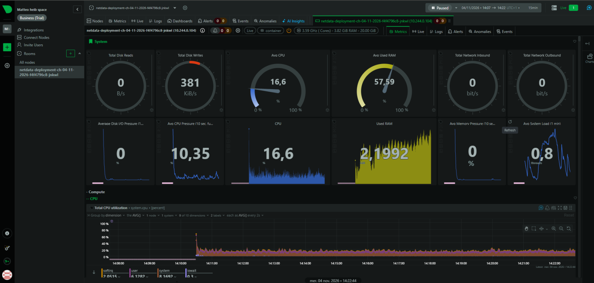
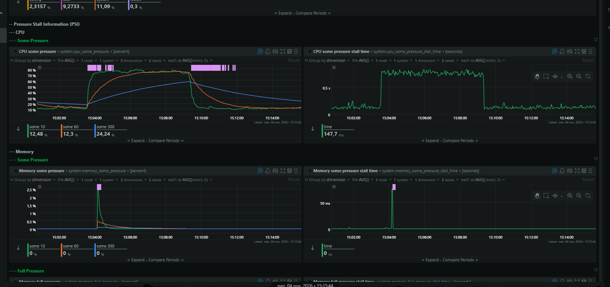

# Observabilité : Netdata

**TP E5 5SDWANA Metz — 4 novembre 2026**  
**Groupe :** Mohamed CHAOUAY TISSIR et Mattéo HEIB  
**Statut :** interface Netdata accessible et visualisation de la charge CPU validée.

## Objectif

Utiliser un outil d'observabilité avec une interface web pour suivre l'utilisation des ressources pendant les tests de charge du projet Kubernetes.

Nous avons retenu **Netdata**. Pour ce TP, le professeur a validé une **supervision des métriques système**, sans imposer une supervision détaillée de chaque pod.

## Configuration utilisée

| Élément | Configuration |
|---|---|
| Outil | Netdata |
| Namespace | `observability-ch-04-11-2026` |
| Deployment | `netdata-deployment-ch-04-11-2026` |
| Replicas | 1 pod (`1/1 Running` lors du contrôle) |
| Service | `netdata-service-ch-04-11-2026` |
| Type de Service | `NodePort` |
| Port applicatif | `19999` |
| NodePort | `31999` |

Cette installation simple utilise un **Deployment unique**. Elle ne comporte pas de DaemonSet Netdata et ne fournit pas, à ce stade, de preuve de métriques individuelles pour les 27 pods.

## Test réalisé

Pendant nos essais de charge CPU, nous avons consulté les graphiques Netdata :

- L'interface présente l'utilisation **CPU**, **RAM** et d'autres métriques système.
- Sur le graphique **CPU Some Pressure (PSI)**, la pression CPU augmente nettement pendant une période de charge, puis redescend après celle-ci.
- Le graphique **CPU some pressure stall time** montre également une période de pression prolongée suivie d'un retour vers les valeurs habituelles.
- On observe aussi un bref pic de pression mémoire au début de la période affichée.

**Important :** la pression CPU (*PSI*) indique le temps pendant lequel des tâches attendent des ressources CPU. Elle ne correspond pas directement au pourcentage d'utilisation CPU. Les captures montrent le comportement du système, pas la consommation d'un pod précis.

## Captures des résultats

**Vue générale de Netdata : métriques CPU, RAM, disque et réseau**

**Variation de la pression CPU pendant le test de charge**

## Bilan

Netdata nous a permis de **visualiser l'effet d'une charge CPU dans une interface web**, ce qui répond à l'objectif d'observabilité retenu pour notre TP. Les tests HPA et les captures de changement de replicas sont documentés séparément dans les dossiers des trois applications.

**Limite :** cette installation surveille principalement des indicateurs système ; elle ne constitue pas une supervision Kubernetes détaillée par namespace ou par pod. Le **Metrics Server** reste le composant utilisé par les HPA pour leurs calculs d'utilisation CPU.
