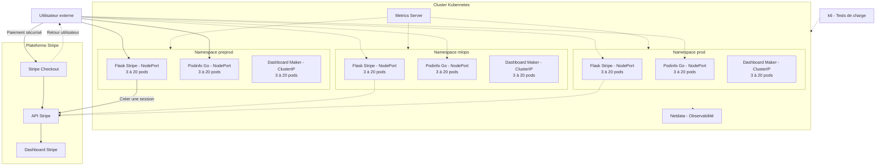

# TP E5 5SDWANA Metz

**Projet Kubernetes — 4 novembre 2026**  
**Groupe :** Mohamed CHAOUAY TISSIR ([@AmazingSchoolBags](https://github.com/AmazingSchoolBags)) et Mattéo HEIB ([@A5ROI](https://github.com/A5ROI))  
**Empreinte du groupe :** `ch-04-11-2026`

## Présentation

Le but du TP est de déployer **trois applications** dans Kubernetes pour réaliser un petit environnement de démonstration (*MVP*). Une application doit permettre de tester un paiement avec **Stripe**.

Nous utilisons **GitHub** pour conserver notre travail, nos fichiers YAML et les différentes étapes du projet. Les déploiements et les résultats seront ajoutés progressivement : ils ne sont pas encore tous réalisés.

## Applications choisies

| Application | Image ou source | Accès | Pourquoi ce choix ? |
|---|---|---|---|
| **Stripe Checkout** | [Exemple officiel Stripe (Python)](https://github.com/stripe-samples/checkout-one-time-payments) | Externe | Réaliser un paiement fictif et vérifier sa présence dans le Dashboard Stripe. Une image sera construite et publiée sur Docker Hub. |
| **Podinfo** | [`stefanprodan/podinfo:6.17.0`](https://hub.docker.com/r/stefanprodan/podinfo) | Externe | Petite application en **Go**, conçue pour être testée facilement avec Kubernetes. |
| **Dashboard Maker** | [`randomsi/dashboard-maker:1.1.1`](https://hub.docker.com/r/randomsi/dashboard-maker) | Interne | Tableau de bord en **Flask**, avec une interface agréable, léger et sans base MySQL à installer. |

Nous avons choisi **Dashboard Maker** plutôt que phpMyAdmin pour éviter d'ajouter une base MySQL et d'autres services. Son fonctionnement avec plusieurs pods sera vérifié pendant le TP, notamment parce qu'il conserve certaines données localement.

Les images sont nos **références de départ**. Le sujet demandant une empreinte dans les noms des composants, nous prévoirons les noms des ressources et des images publiées avec `ch-04-11-2026`.
---
### Choix et taille des images Docker

Nous avons privilégié des **images Docker légères, simples à déployer et adaptées aux besoins du TP**, afin de limiter la consommation des ressources de Minikube et de consacrer davantage de temps aux tests Kubernetes.

| Application | Image Docker | Taille | Justification du choix |
|---|---|---|---|
| **Stripe Checkout** | `mheib007/stripe-app:v3` | 61,31 Mo* | Application de paiement Stripe, simple à tester. |
| **Podinfo** | `stefanprodan/podinfo:6.17.0` | ≈ 34 Mo** | Application Go légère, adaptée aux tests Kubernetes. |
| **Dashboard Maker** | `randomsi/dashboard-maker:1.1.1` | ≈ 47 Mo** | Interface Flask sans base de données externe. |

* Taille locale non compressée, vérifiée avec `docker image inspect`.
** Tailles compressées indiquées sur Docker Hub, à ne pas comparer directement à la taille locale Stripe.
  
## 🏗️ Architecture du projet

Le projet repose sur trois environnements Kubernetes :
**mlops**, **preprod** et **prod**.

Chaque environnement héberge trois applications avec
un HPA permettant de passer de 3 à 20 pods.

### Application 1 : Stripe Checkout

**Statut : premier paiement de test validé**

L'application Stripe Checkout permet de simuler des paiements en ligne depuis notre environnement Kubernetes.

Nous utilisons l'exemple Stripe adapté et conteneurisé par Mattéo, avec l'image Docker `mheib007/stripe-app:v3`.

**Configuration Kubernetes :**

- Namespace : `preprod-ch-04-11-2026`
- Deployment : `stripe-deployment-ch-04-11-2026`
- Service : `LoadBalancer`, port `4242`
- Nombre de replicas initial : 3
- Configuration : Secret Kubernetes contenant les clés API Stripe et l'identifiant du prix
- Ressources : 100m CPU et 128 MiB de RAM demandés par conteneur

**Résultats des premiers tests :**

L'application est accessible depuis le poste de test grâce à un transfert de port Kubernetes. Un paiement fictif de **250 €** a été effectué avec succès et confirmé dans le Dashboard Stripe.

Le HPA, les tests de charge et la reproduction dans les autres namespaces restent à réaliser.

[Consulter les captures et les résultats du test Stripe](captures/App-Stripe/README.md)

### Fonctionnement

- **NodePort** : accès externe aux applications Stripe et Podinfo.
- **ClusterIP** : accès interne à Dashboard Maker.
- **HPA** : adaptation automatique entre 3 et 20 replicas.
- **Metrics Server** : récupération de la consommation CPU.
- **k6** : génération de charge HTTP.
- **Netdata** : visualisation des performances.
- **Stripe Checkout** : réalisation et vérification des paiements tests.

---
## Organisation Kubernetes

Nous devons déployer les mêmes applications dans **trois environnements** :

- `mlops`
- `preprod`
- `prod`

Pour chaque application, nous prévoyons :

- Un **Deployment** avec **3 pods** au minimum.
- Un **Service** : accès externe pour Stripe et Podinfo (`NodePort`) ; accès interne pour Dashboard Maker (`ClusterIP`).
- Un **HPA** (*Horizontal Pod Autoscaler*) pour passer de **3 à 20 pods maximum** selon la charge.
- Des limites de **CPU et de mémoire** adaptées après nos mesures.

Les paramètres et les clés Stripe seront séparés du code avec des **ConfigMaps** et des **Secrets**. **Aucune clé secrète ne sera publiée sur GitHub.**

## Tests à réaliser

1. Vérifier que les trois applications démarrent et répondent correctement.
2. Effectuer un **paiement de test Stripe**, puis retrouver la transaction dans le Dashboard Stripe.
3. Utiliser **k6** pour générer du trafic sur chaque application.
4. Observer l'augmentation et la diminution du nombre de pods grâce au **HPA**.
5. Déployer un outil d'observabilité avec interface web, par exemple **Netdata**, pour suivre la charge.

Nous conserverons les résultats des tests, les commandes exécutées, les logs et les événements Kubernetes.

## Répartition du travail

| Membre | Rôle principal |
|---|---|
| **Mohamed CHAOUAY TISSIR** | Création et organisation du dépôt GitHub, rédaction du README, explication des choix, suivi de la documentation et aide pendant le TP. |
| **Mattéo HEIB** | Déploiements sur son PC, création des fichiers Kubernetes, tests des applications, HPA et observabilité, puis ajout des fichiers dans le dépôt. |

Nous travaillons ensemble sur les vérifications, les difficultés rencontrées et la préparation de l'oral. **Chacun rédige son propre compte rendu**, comme demandé dans le sujet.

## Suivi du projet

- [x] Dépôt GitHub créé.
- [x] Trois applications choisies.
- [ ] Images Docker Hub disponibles avec l'empreinte demandée.
- [ ] Applications déployées dans `mlops`, `preprod` et `prod`.
- [ ] Paiement Stripe validé.
- [ ] Tests k6 et HPA réalisés.
- [ ] Observabilité installée et testée.
- [ ] Logs, captures, historique des commandes et schéma d'architecture ajoutés.
- [ ] Comptes rendus individuels et oral préparés.

Nous ferons des **commits réguliers avec des messages explicites**, au fur et à mesure de l'avancement du projet. Les erreurs rencontrées et leur résolution seront également documentées.

## Documentation utile

- [Sujet Stripe Checkout](https://docs.stripe.com/payments/checkout)
- [Kubernetes : Deployments](https://kubernetes.io/docs/concepts/workloads/controllers/deployment/)
- [Kubernetes : Services](https://kubernetes.io/docs/concepts/services-networking/service/)
- [Kubernetes : HPA](https://kubernetes.io/docs/tasks/run-application/horizontal-pod-autoscale/)
- [Podinfo sur Docker Hub](https://hub.docker.com/r/stefanprodan/podinfo)
- [Dashboard Maker sur Docker Hub](https://hub.docker.com/r/randomsi/dashboard-maker)
