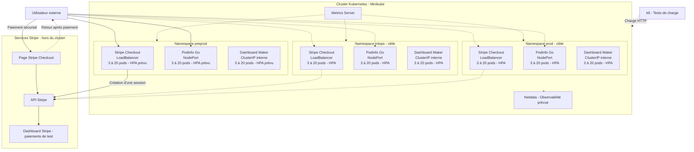

# TP E5 5SDWANA Metz

**Projet Kubernetes — 4 novembre 2026**  
**Groupe :** Mohamed CHAOUAY TISSIR ([@AmazingSchoolBags](https://github.com/AmazingSchoolBags)) et Mattéo HEIB ([@A5ROI](https://github.com/A5ROI))  
**Empreinte du groupe :** `ch-04-11-2026`

## Présentation

Le but du TP est de déployer **trois applications** dans Kubernetes pour réaliser un environnement de démonstration (*MVP*), dont une application permettant de tester un paiement avec **Stripe**.

Nous utilisons **GitHub** pour conserver les fichiers YAML, expliquer nos choix et suivre l'avancement du projet grâce à des commits réguliers. Les trois applications fonctionnent déjà dans **Preprod** ; les autres environnements et les tests d'autoscaling seront documentés au fur et à mesure.

## Applications choisies

| Application | Image Docker | Accès prévu | Pourquoi ce choix ? |
|---|---|---|---|
| **Stripe Checkout** | `mheib007/stripe-app:v3` | Externe : `LoadBalancer` | Application issue d'un exemple Stripe, adaptée et conteneurisée par Mattéo pour tester un paiement fictif. |
| **Podinfo** | [`stefanprodan/podinfo:6.17.0`](https://hub.docker.com/r/stefanprodan/podinfo) | Externe : `NodePort` | Application légère en **Go**, pratique pour les tests Kubernetes. |
| **Dashboard Maker** | [`randomsi/dashboard-maker:1.1.1`](https://hub.docker.com/r/randomsi/dashboard-maker) | Interne : `ClusterIP` | Tableau de bord en **Flask**, avec une interface web et sans base MySQL externe. |

Nous avons choisi **Dashboard Maker** plutôt que phpMyAdmin pour éviter de déployer une base MySQL et des services supplémentaires. L'application conserve certaines données localement : il faudra en tenir compte avec plusieurs replicas.

### Choix et taille des images Docker

Nous avons recherché des **images plutôt légères et simples à déployer**, pour consacrer davantage de temps à Kubernetes, aux tests de charge et à l'autoscaling.

| Application | Taille connue | Méthode |
|---|---:|---|
| **Stripe Checkout** (`mheib007/stripe-app:v3`) | **61,31 Mo** | Taille locale non compressée, mesurée avec `docker image inspect`. |
| **Podinfo** (`6.17.0`) | **≈ 34 Mo** | Taille compressée indiquée sur Docker Hub (AMD64). |
| **Dashboard Maker** (`1.1.1`) | **≈ 47 Mo** | Taille compressée indiquée sur Docker Hub (AMD64). |

*Les tailles locales et compressées sont données à titre indicatif et ne sont pas directement comparables.*

## 🏗️ Architecture du projet

L'architecture cible comporte **trois environnements Kubernetes** : `mlops`, `preprod` et `prod`. Chaque environnement doit héberger les mêmes trois applications, avec **3 pods minimum et 20 maximum par application** grâce à un HPA.

> Ce schéma représente **l'objectif final** du TP. Pour l'instant, le déploiement et les premiers tests des trois applications sont confirmés dans Preprod.

### Fonctionnement des composants

- **LoadBalancer** : Service utilisé par Stripe ; l'accès a pour l'instant été vérifié avec un `port-forward`.
- **NodePort** : Service utilisé pour rendre Podinfo accessible depuis l'extérieur du cluster.
- **ClusterIP** : Service interne utilisé pour Dashboard Maker.
- **HPA** : adaptation automatique du nombre de pods entre 3 et 20 selon la charge CPU (à mettre en place).
- **Metrics Server** : fournit les métriques CPU utilisées par le HPA.
- **k6** : outil prévu pour les tests de charge HTTP.
- **Netdata** : outil d'observabilité web envisagé pour suivre les performances.
- **Stripe Checkout** : paiement de test et vérification de la transaction dans Stripe.

## Premiers résultats dans Preprod

### Application 1 : Stripe Checkout

**Statut : paiement de test validé.**

L'application Stripe utilise l'image Docker **`mheib007/stripe-app:v3`**, réalisée à partir d'un [exemple Stripe](https://github.com/stripe-samples/checkout-one-time-payments) et adaptée par Mattéo.

- **Namespace :** `preprod-ch-04-11-2026`
- **Deployment :** `stripe-deployment-ch-04-11-2026`
- **Service :** `LoadBalancer`, port `4242`
- **Replicas initiaux :** 3
- **Configuration :** Secret Kubernetes pour les clés Stripe et l'identifiant du prix
- **Ressources :** 100m CPU et 128 MiB de RAM demandés par conteneur ; limites de 250m CPU et 256 MiB de RAM

L'application a été testée depuis un poste Windows avec un transfert de port Kubernetes. Un **paiement fictif de 250 €** a été effectué et apparaît comme **réussi dans le Dashboard Stripe en mode test**.

[Voir les captures et les résultats du test Stripe](App-Stripe/README.md)

### Application 2 : Podinfo (Go)

**Statut : application accessible, test HTTP validé.**

Podinfo **v6.17.0** fonctionne dans `preprod-ch-04-11-2026`. L'interface a été ouverte dans un navigateur et une requête HTTP depuis Windows a retourné **200 OK**. L'accès a été testé avec un transfert de port Kubernetes sur le port `9898`.

[Voir les captures et les résultats Podinfo](App-Podinfo/README.md)

### Application 3 : Dashboard Maker (Flask)

**Statut : accès interne et test HTTP validés.**

Dashboard Maker utilise un Service **ClusterIP**, sur le port `5000`, dans `preprod-ch-04-11-2026`. Une requête HTTP depuis Minikube a retourné **200 OK**.

[Voir les captures et les résultats Dashboard Maker](App-Dashboard/README.md)

### Vérification des replicas dans Preprod

La commande `kubectl get pods -n preprod-ch-04-11-2026` montre que les **9 pods sont opérationnels**, avec `1/1 Ready`, le statut `Running` et aucun redémarrage sur la capture.

| Application | Pods opérationnels | État |
|---|---:|---|
| Stripe Checkout | 3/3 | Running |
| Podinfo | 3/3 | Running |
| Dashboard Maker | 3/3 | Running |
| **Total** | **9/9** | **Opérationnel** |

## Organisation Kubernetes et tests restants

Nous devons reproduire les mêmes applications dans les trois environnements **`mlops`**, **`preprod`** et **`prod`**, avec des noms de ressources utilisant l'empreinte `ch-04-11-2026`.

Pour terminer le TP, nous prévoyons de :

1. Vérifier les applications et leurs trois replicas dans **les trois namespaces**.
2. Configurer un **HPA de 3 à 20 pods** pour chaque application, avec des ressources CPU et mémoire adaptées.
3. Réaliser des **tests de charge avec k6** et observer l'augmentation puis la diminution du nombre de pods.
4. Installer une **solution d'observabilité avec interface web** (par exemple Netdata).
5. Conserver les **captures, événements Kubernetes, logs et historiques des commandes**, ainsi que les erreurs rencontrées et leurs corrections.

Les clés Stripe doivent rester dans des **Secrets Kubernetes**, sans publier de véritables clés API sur GitHub. Les éventuels fichiers d'exemple utiliseront uniquement des valeurs fictives.

## Répartition du travail

| Membre | Rôle principal |
|---|---|
| **Mohamed CHAOUAY TISSIR** | Organisation du dépôt GitHub, rédaction du README, documentation des choix et des résultats, aide technique pendant le TP. |
| **Mattéo HEIB** | Création des fichiers YAML et des images nécessaires, déploiements sur son PC, tests Kubernetes, HPA et observabilité. |

Nous travaillons ensemble sur les vérifications et la préparation de l'oral. **Chacun rédige son propre compte rendu**, comme demandé par le professeur.

## Suivi du projet

- [x] Dépôt GitHub créé et documenté.
- [x] Trois applications choisies.
- [x] Applications fonctionnelles dans **Preprod** : 9 pods sur 9.
- [x] Paiement Stripe fictif de **250 €** validé.
- [x] Schéma d'architecture Mermaid et premières captures ajoutés.
- [ ] Vérification et conformité de toutes les images / noms avec l'empreinte demandée.
- [ ] Déploiement vérifié dans **mlops**, **preprod** et **prod**.
- [ ] Tests de charge k6 et autoscaling HPA réalisés pour les trois applications.
- [ ] Observabilité installée et testée.
- [ ] Logs, événements et historiques de commandes rassemblés.
- [ ] Comptes rendus individuels et oral préparés.

Nous réalisons des **commits réguliers et explicites** pour suivre l'avancement du projet.

## Documentation utile

- [Stripe Checkout](https://docs.stripe.com/payments/checkout)
- [Kubernetes : Deployments](https://kubernetes.io/docs/concepts/workloads/controllers/deployment/)
- [Kubernetes : Services](https://kubernetes.io/docs/concepts/services-networking/service/)
- [Kubernetes : HPA](https://kubernetes.io/docs/tasks/run-application/horizontal-pod-autoscale/)
- [Podinfo sur Docker Hub](https://hub.docker.com/r/stefanprodan/podinfo)
- [Dashboard Maker sur Docker Hub](https://hub.docker.com/r/randomsi/dashboard-maker)
