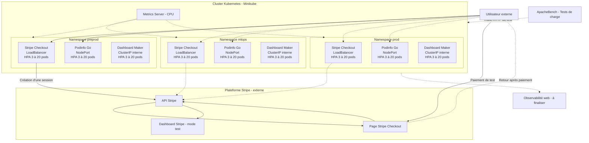
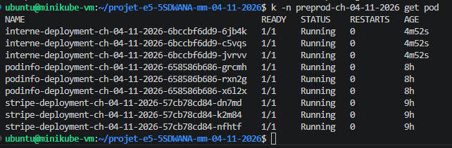
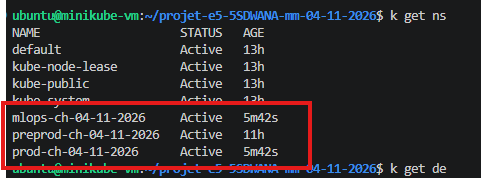
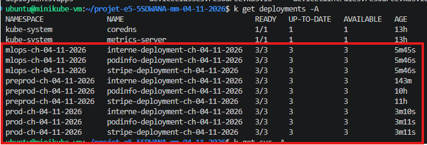
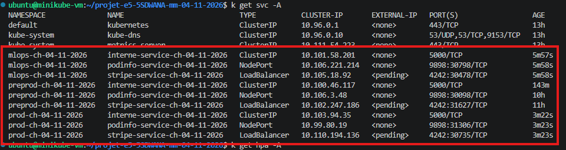
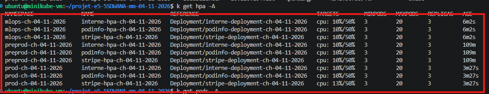
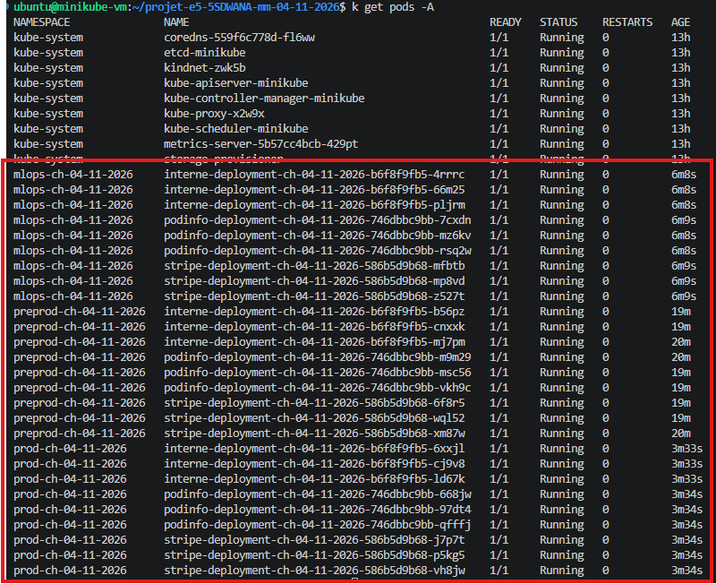

# TP E5 5SDWANA Metz

**Projet Kubernetes — 4 novembre 2026**  
**Groupe :** Mohamed CHAOUAY TISSIR ([@AmazingSchoolBags](https://github.com/AmazingSchoolBags)) et Mattéo HEIB ([@A5ROI](https://github.com/A5ROI))  
**Empreinte du groupe :** `ch-04-11-2026`

## Présentation

L'objectif du TP est de déployer **trois applications dans Kubernetes**, dont une permettant de réaliser des paiements fictifs avec **Stripe**. Nous utilisons **Minikube** pour les déploiements et **GitHub** pour conserver nos fichiers YAML, les captures, les résultats des tests et l'historique de nos modifications.

Les applications sont désormais déployées dans **trois environnements : `mlops`, `preprod` et `prod`**. Les dernières vérifications montrent **27 pods opérationnels**, répartis sur 9 Deployments.

## Applications choisies

| Application | Image Docker | Accès | Pourquoi ce choix ? |
|---|---|---|---|
| **Stripe Checkout** | [`mheib007/stripe-app:v3`](https://hub.docker.com/r/mheib007/stripe-app) | Externe : `LoadBalancer` | Exemple de paiement Stripe adapté et conteneurisé par Mattéo. |
| **Podinfo** | [`stefanprodan/podinfo:6.17.0`](https://hub.docker.com/r/stefanprodan/podinfo) | Externe : `NodePort` | Application légère en **Go**, facile à tester avec Kubernetes. |
| **Dashboard Maker** | [`randomsi/dashboard-maker:1.1.1`](https://hub.docker.com/r/randomsi/dashboard-maker) | Interne : `ClusterIP` | Application **Flask** avec interface web, sans base MySQL externe. |

Nous avons retenu **Dashboard Maker plutôt que phpMyAdmin** pour éviter d'ajouter MySQL et d'autres services. Sa configuration pouvant être conservée localement, la synchronisation des données entre plusieurs pods reste une limite à prendre en compte.

### Choix et taille des images Docker

Nous avons cherché des **images légères et simples à déployer**, pour consacrer davantage de temps aux tests Kubernetes et à l'autoscaling.

| Application | Taille indicative | Mesure |
|---|---:|---|
| Stripe Checkout | **61,31 Mo** | Taille locale non compressée, avec `docker image inspect`. |
| Podinfo | **≈ 34 Mo** | Taille compressée indiquée sur Docker Hub (AMD64). |
| Dashboard Maker | **≈ 47 Mo** | Taille compressée indiquée sur Docker Hub (AMD64). |

*Les tailles locales et compressées ne sont pas directement comparables.*

## 🏗️ Architecture Kubernetes

Nous avons déployé les mêmes trois applications dans les namespaces **`mlops-ch-04-11-2026`**, **`preprod-ch-04-11-2026`** et **`prod-ch-04-11-2026`**. Chaque application dispose d'un **HPA** configuré de **3 à 20 replicas**, avec une cible CPU de **50 %**.

Le diagramme montre l'architecture logique. La solution d'observabilité est **prévue, mais pas encore validée**.

### Fonctionnement des principaux composants

- **Deployment** : assure la gestion des pods de chaque application.
- **LoadBalancer** : type de Service utilisé pour Stripe. L'accès a été validé avec un `port-forward` ; les adresses `EXTERNAL-IP` étaient encore en attente (`<pending>`) sur Minikube.
- **NodePort** : Service utilisé pour Podinfo. Le port externe est attribué automatiquement par Kubernetes.
- **ClusterIP** : Service utilisé pour Dashboard Maker, accessible depuis l'intérieur du cluster.
- **HPA** : augmente ou réduit automatiquement le nombre de pods selon la consommation CPU, dans la limite de 3 à 20 replicas.
- **Metrics Server** : fournit les métriques CPU nécessaires au HPA.
- **ApacheBench (`ab`)** : génère la charge HTTP pendant nos tests.
- **Observabilité web** : reste à installer et à valider, par exemple avec Netdata.

### Avantages et limites des technologies utilisées

| Technologie | Avantages | Inconvénients |
|---|---|---|
| **Minikube** | Simple pour tester Kubernetes sur une machine virtuelle. | Ressources limitées par la puissance du PC. |
| **Docker** | Facilite le déploiement des applications avec des images prêtes à l'emploi. | Les images peuvent être volumineuses ou nécessiter des adaptations. |
| **Kubernetes** | Gère les pods, les Services et la disponibilité des applications. | Configuration plus complexe qu'un simple conteneur Docker. |
| **HPA** | Adapte automatiquement le nombre de pods selon la charge. | Dépend des métriques CPU et des ressources configurées. |
| **ApacheBench** | Simple pour réaliser des tests de charge HTTP. | Ne simule pas un parcours utilisateur complet. |
| **Stripe Checkout** | Permet de tester facilement un paiement sécurisé. | Nécessite une configuration API et une connexion à Stripe. |
| **Podinfo** | Application Go légère, adaptée aux tests Kubernetes. | Application de démonstration, sans véritable fonctionnalité métier. |
| **Dashboard Maker** | Interface web simple et sans base MySQL externe. | Les données locales peuvent différer entre les replicas. |

## Validation des applications dans Preprod

### Application 1 : Stripe Checkout

**Statut : paiement fictif validé.**

L'application utilise l'image [`mheib007/stripe-app:v3`](https://hub.docker.com/r/mheib007/stripe-app), adaptée par Mattéo à partir d'un [exemple Stripe](https://github.com/stripe-samples/checkout-one-time-payments).

- **Namespace :** `preprod-ch-04-11-2026`
- **Deployment :** `stripe-deployment-ch-04-11-2026`
- **Service :** `LoadBalancer`, port applicatif `4242`
- **Replicas au repos :** 3
- **Configuration :** clés Stripe et identifiant du prix injectés par un Secret Kubernetes

Un paiement fictif de **250 €** a été réalisé et confirmé comme **réussi dans le Dashboard Stripe en mode test**. Le site a également été testé depuis Windows via un transfert de port Kubernetes.

[Voir les captures et les résultats de Stripe](App-Stripe/README.md)

### Application 2 : Podinfo (Go)

**Statut : interface et test HTTP validés.**

L'application Podinfo affichait la version **6.17.0** lors du test. L'interface était accessible dans le navigateur et la vérification HTTP depuis Windows a retourné **200 OK**, via le port `9898`.

[Voir les captures et les résultats de Podinfo](App-Podinfo/README.md)

### Application 3 : Dashboard Maker (Flask)

**Statut : accès interne et test HTTP validés.**

L'application utilise le Service `interne-service-ch-04-11-2026`, de type **ClusterIP**, sur le port `5000`. Un appel HTTP effectué depuis Minikube a retourné **200 OK**.

[Voir les captures et les résultats de Dashboard Maker](App-Dashboard/README.md)

### Vérification des trois replicas par application

Lors de notre première vérification dans `preprod-ch-04-11-2026`, les **9 pods** étaient en état `Running`, `1/1 Ready` et sans redémarrage.

| Application | Pods opérationnels |
|---|---:|
| Stripe Checkout | 3/3 |
| Podinfo | 3/3 |
| Dashboard Maker | 3/3 |
| **Total Preprod** | **9/9** |

## Tests de charge et autoscaling HPA

Nous avons utilisé **ApacheBench** pour générer du trafic dans **Preprod**. Les événements Kubernetes `SuccessfulRescale` et `ScalingReplicaSet` montrent que les HPA ont augmenté puis réduit le nombre de replicas.

| Application | Minimum configuré | Maximum configuré | Pic de replicas demandé observé | Retour au repos |
|---|---:|---:|---:|---:|
| **Stripe Checkout** | 3 | 20 | **7** | 3 |
| **Podinfo** | 3 | 20 | **11** | 3 |
| **Dashboard Maker** | 3 | 20 | **7** | 3 |

La cible CPU des trois HPA est de **50 %**. Les pics indiqués proviennent des événements de scaling ; ils ne prouvent pas, à eux seuls, que tous les nouveaux pods étaient prêts au même instant.

Pour Stripe, le test ApacheBench s'est interrompu avant l'envoi de toutes les requêtes prévues avec une erreur `Connection refused`. **Le scaling a malgré tout été observé et documenté**. Les détails de chaque test et les captures sont disponibles dans les dossiers des applications : [Stripe](App-Stripe/README.md), [Podinfo](App-Podinfo/README.md) et [Dashboard Maker](App-Dashboard/README.md).

## Validation des trois environnements Kubernetes

Les trois environnements ont été vérifiés avec les commandes `kubectl get namespaces`, `kubectl get deployments -A`, `kubectl get pods -A`, `kubectl get svc -A` et `kubectl get hpa -A`.

| Environnement | Deployments disponibles | Pods opérationnels | HPA configurés |
|---|---:|---:|---:|
| `mlops-ch-04-11-2026` | 3/3 | 9/9 | 3 |
| `preprod-ch-04-11-2026` | 3/3 | 9/9 | 3 |
| `prod-ch-04-11-2026` | 3/3 | 9/9 | 3 |
| **Total** | **9/9** | **27/27** | **9** |

Sur les captures, les **27 pods sont `Running` et `1/1 Ready`**, sans redémarrage. Les **9 HPA** disposent de métriques CPU et sont configurés entre **3 et 20 pods**.

Pour tenir compte de la capacité du PC utilisé avec Minikube, nous avons **ajusté les ressources CPU** dans les YAML, puis retesté les applications. Les ports `NodePort` ont également été laissés à l'attribution automatique de Kubernetes. Les valeurs précises sont celles des manifests mis à jour dans le dépôt.

### Captures des trois environnements

**Namespaces créés**

**Deployments disponibles**

**Services et types d'accès**

**Neuf HPA configurés**

**Vingt-sept pods opérationnels**

Ces captures valident la disponibilité des ressources Kubernetes dans les trois namespaces. Les tests HTTP détaillés et les démonstrations de montée en charge ont principalement été réalisés dans **Preprod**.

## Observabilité : Netdata

Nous avons installé **Netdata** dans le namespace `observability-ch-04-11-2026` afin de visualiser les performances système de notre environnement Minikube.

L'application utilise un **Deployment** et un Service **NodePort 31999**, permettant d'accéder à son interface web.

Lors d'un test de charge CPU, nous avons observé une augmentation de la pression CPU sur les graphiques Netdata, puis une diminution après le test.

Cette solution nous permet de suivre les métriques système (CPU, RAM, disque et réseau). Elle ne fournit pas de supervision détaillée par pod, mais répond aux besoins d'observabilité validés par notre professeur.

**[Consulter les captures et les résultats Netdata](Observabilite/README.md)**

## Points à finaliser

1. Mettre en place et tester une **solution d'observabilité avec interface web** pour suivre les ressources et la charge.
2. Rassembler les **logs, commandes et éventuelles erreurs rencontrées**, ainsi que leurs résolutions.
3. Vérifier que les **noms des ressources et images** respectent les consignes du sujet et que les tags Docker réellement déployés correspondent aux références documentées.
4. Vérifier, si nécessaire, l'accès externe des Services Stripe `LoadBalancer` (leur `EXTERNAL-IP` apparaissait encore comme `<pending>`).
5. Finaliser les **comptes rendus individuels** et préparer l'oral.

**Sécurité :** aucune clé secrète Stripe ne doit être publiée dans ce dépôt public. Les Secrets Kubernetes sont créés à partir de valeurs non versionnées ; les éventuels exemples YAML ne doivent contenir que des valeurs fictives. Toute clé ayant déjà été publiée doit être révoquée et remplacée, car elle peut rester visible dans l'historique Git.

## Répartition du travail

| Membre | Rôle principal |
|---|---|
| **Mohamed CHAOUAY TISSIR** | Organisation du dépôt GitHub, README, architecture, justification des choix, documentation des résultats et aide technique. |
| **Mattéo HEIB** | Création et adaptation des manifests YAML, déploiements sur Minikube, tests des applications, HPA et observabilité. |

Nous avons travaillé ensemble sur les vérifications et la préparation de l'oral. **Chacun réalise son propre compte rendu**, conformément aux consignes.

## Suivi du projet

- [x] Dépôt GitHub public créé et documenté.
- [x] Trois applications Docker choisies et déployées.
- [x] Paiement fictif Stripe de **250 €** validé.
- [x] Trois namespaces Kubernetes opérationnels : `mlops`, `preprod`, `prod`.
- [x] **9 Deployments** et **27 pods** opérationnels.
- [x] **9 HPA** configurés entre 3 et 20 replicas.
- [x] Tests de charge **ApacheBench** et montée/descente des replicas observées dans Preprod.
- [x] Architecture Mermaid et captures des principales validations ajoutées.
- [x] Observabilité avec interface web installée et validée.
- [x] Vérification finale de la conformité des images et de l'accès LoadBalancer.
- [x] Logs, historique des commandes et rapports individuels finalisés.

Nous effectuons des **commits réguliers et explicites**, afin de conserver l'historique des essais, des modifications et des corrections.

## Documentation utile

- [Documentation Stripe Checkout](https://docs.stripe.com/payments/checkout)
- [Kubernetes : Deployments](https://kubernetes.io/docs/concepts/workloads/controllers/deployment/)
- [Kubernetes : Services](https://kubernetes.io/docs/concepts/services-networking/service/)
- [Kubernetes : HPA](https://kubernetes.io/docs/tasks/run-application/horizontal-pod-autoscale/)
- [Podinfo sur Docker Hub](https://hub.docker.com/r/stefanprodan/podinfo)
- [Dashboard Maker sur Docker Hub](https://hub.docker.com/r/randomsi/dashboard-maker)
